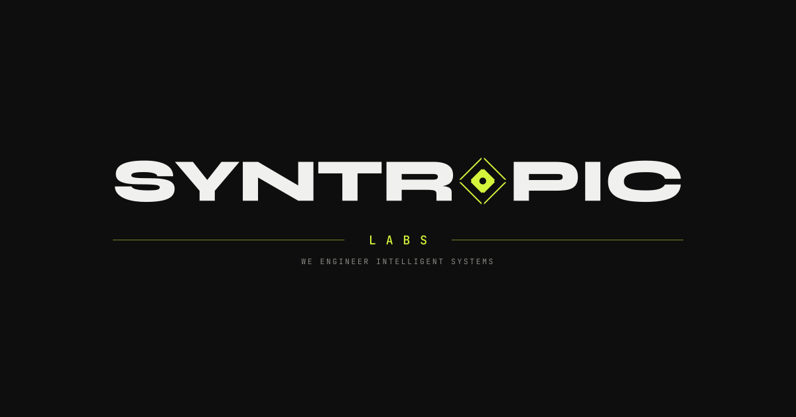

  

    

  <h1>Syntropic Labs Website</h1>
  
The official production repository for <strong>Syntropic-Labs-HQ.github.io</strong>.

  

    <a href="https://syntropic-labs-hq.github.io/"><strong>Live Website</strong></a> •
    <a href="#technical-architecture">Architecture</a> •
    <a href="#deployment--cicd">CI/CD</a> •
    <a href="#license">License</a>
  

  

    
    
    
  

---

## Technical Architecture

This website is engineered with zero runtime dependencies and zero framework overhead:

- **Core**: Semantic HTML5, Vanilla JavaScript (ES6+), and Modular CSS3.
- **Visual Engine**: Custom 2D/3D hardware-accelerated canvas engine running a real-time procedural node network at 60 FPS.
- **Design System**: Tailored dark theme (`#0e0e0e`), Geist typography, and signature neon accent (`#d4f53c`).
- **Social Graph**: Complete Open Graph protocol and Twitter Card integration.

---

## Deployment & CI/CD

Deployment is fully automated through GitHub Actions:

- Every push to the `main` branch triggers `.github/workflows/deploy.yml`.
- The workflow packages the static assets and deploys directly to GitHub Pages.
- **Production URL**: [https://syntropic-labs-hq.github.io/](https://syntropic-labs-hq.github.io/)

---

## Author

Created by Shahsawar Orakzai ([@orakzai-io](https://github.com/orakzai-io)), Founder of Syntropic Labs.

---

## License

This project is licensed under the [MIT License](LICENSE).
